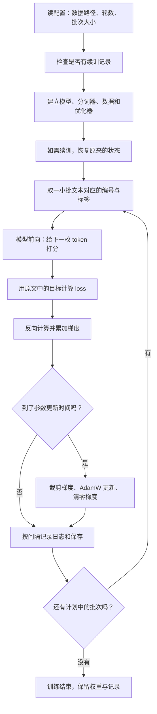

# 第 1 课：先建立预训练的整个过程地图

今天要弄懂的是：你在 RTX 4090 上运行的程序，究竟反复做了什么，才把一组随机参数变成了能续写中文的模型。

学完后，你应该能用自己的话讲清这句话：**把文本变成练习题，让模型预测下一个 token，用真实文本判分，再根据误差调整参数。**

建议用 60–90 分钟。准备好 [带中文注释的训练脚本](../../trainer/train_pretrain.py) 和 [云端日志](../../logs/pretrain.log)。先读本课，再在代码中寻找同一阶段。本课先把各部分连起来，后面的课再展开标签移位、注意力和梯度公式。

## 1. 从一句话开始：训练题目从哪里来？

假设文本是：

> 春天到了，花开了。

模型的任务是接着已有的内容预测下一小段。以当前分词器为例，这句话的正文分成：

```text
春 | 天 | 到了 | ， | 花 | 开 | 了 | 。
```

每一小段叫 **token**。这里“到了”是一枚 token，说明 token 不一定是一个字，也不一定是一个完整词。分词器还会把这些单位换成整数编号，以便模型计算。

这句话能够自己提供答案：

| 已经给模型的前文 | 这次练习的正确目标 |
|---|---|
| 开始标记 | 春 |
| 开始标记、春 | 天 |
| 开始标记、春、天 | 到了 |
| 开始标记、春、天、到了 | ， |
| 开始标记、春、天、到了、， | 花 |

所以这里不需要人工为每个位置另写一份答案，**下一个 token 就在原文里**。这种从数据自身构造目标的方式叫自监督学习。它不意味着没有标签，而是标签由原文产生。

模型还要学会结束：正文最后的“。”预测结束标记 EOS。BOS 是开始标记，PAD 是把不同长度样本补齐时使用的占位符；PAD 对应的目标不会参与判分。

还有一个条件：模型预测“花”时，不能提前看到“花”和后面的内容。本项目用因果注意力限制它只能使用当前位置及之前的内容。训练时可以一次计算各位置的预测，但每个位置都有这个限制。

**停下来想一想**：如果删掉这句话里的“花”，还能把“花”作为下一位置的目标吗？这个训练脚本不会替你补出真实答案，只会学习实际输入文本中的序列。

## 2. 模型到底在改什么？

分词器负责把文本换成编号。模型负责利用前文，对下一枚 token 做预测。二者是不同对象。

模型内部有很多可学习的数值，叫**参数**。你可以先把它们理解为一张庞大的、相互关联的“预测规则表”，但它不是把句子原样存进字典。相同的参数会被用于处理很多不同文本。

本次模型有约 **6391 万个参数**。当没有加载已有权重、也没有恢复检查点时，它从随机参数开始。训练反复调整这些数值，让原文中的正确 token 得到更高的预测概率。

你的这次实验使用已有分词器。训练脚本调整的是模型参数，并没有同时重新训练分词器的词表。

## 3. 先认识九个词，足够读第一遍代码

| 名称 | 先用这句话理解 | 代码或日志中的位置 |
|---|---|---|
| token | 分词器划出的一个文本单位，模型拿到它的编号 | `input_ids` |
| 参数 parameter | 模型通过训练调整的数值 | `model.parameters()` |
| logits | 对每个候选 token 给出的分数，尚未变成概率 | `res.logits`，在模型内部计算 |
| loss | 给正确目标的概率不够高时，付出的误差代价 | `res.loss` |
| 梯度 gradient | 参数变化怎样影响当前 loss 的方向信息 | `backward()` 计算 |
| 优化器 optimizer | 使用梯度与自身状态来修改参数的规则 | 本项目用 AdamW |
| batch | 一次取出的多条样本，默认 32 条 | `batch_size` |
| step | 本脚本中，已经处理的小批次数 | 日志 `(step/iters)` |
| epoch | 按本轮安排遍历一次数据集 | `epochs=2`，遍历两轮 |

现在不用背数学定义。先能在地图上把这些词放到正确位置。

## 4. 整个程序分为“准备”和“反复练习”

Python 先读到 `def train_epoch(...)` 时，只是在定义函数。真正直接启动脚本后，会进入下方的 `if __name__ == "__main__":`，做好准备，再调用这个函数。

先看整体地图：



“准备”只在启动时做一遍；预测、判分、计算梯度是每个批次都会做的；更新、打印日志、保存则各有自己的频率。

## 5. 对照主程序：准备什么，为什么？

打开脚本下半部分，用 `# ========== 1...9` 定位。这些编号对应下面的解释。

| 准备阶段 | 浅显解释 | 你这次实验的对应事实 |
|---|---|---|
| 读取 `args` | 给实验写好安排：用哪些数据、训练几轮、一次几条 | 默认两轮、batch=32、长度=340 |
| 1. 环境与随机种子 | 确定计算环境，控制随机初始化与打乱 | 云端使用单张 RTX 4090 |
| 2. 模型配置与断点检查 | 写好结构说明书，检查上次学到哪里 | 8 层、隐藏维度 768；可检测续训文件 |
| 3. 混合精度 | 给部分计算选择合适的数值精度 | 云端默认 bf16；先知道它是计算设置 |
| 4. SwanLab | 准备一份可以画曲线的实验记录 | 云端 run ID 为 `p4gibyx8` |
| 5. 模型、数据、优化器 | 建预测器、练习题供应器和参数更新规则 | `model`、`train_ds`、AdamW |
| 6. 恢复状态 | 有旧记录时，恢复参数、优化器和训练位置 | 云端日志说明跳过前 1000 个小批次 |
| 7. 编译与多卡包装 | 可选的计算加速与多卡协作 | 默认单卡、不启用 compile |
| 8. 开始训练 | 每轮安排样本顺序，再逐批调用 `train_epoch` | 日志从第 1 轮走到第 2 轮末 |
| 9. 清理 | 多卡场景下释放进程组 | 单设备不执行这部分 |

有三个容易混淆的对象：

- `lm_config` 是**结构说明书**：规定层数、维度等；它不是学到的知识。
- `model` 是**预测器**：内部有可以被更新的参数。
- `optimizer` 是**更新规则及其状态**：创建它还不会让模型自动学习。

同样，`Dataset` 和 `DataLoader` 也有分工：前者负责“这一条样本是什么”，后者负责“这次把哪些样本组成一批送过来”。

## 6. 对照 `train_epoch`：一批数据经历什么？

回到脚本上半部分，沿着新增的 `【A】` 到 `【H】` 注释阅读。

**A：拿到练习材料。**

`input_ids` 是输入编号，`labels` 是目标。正式训练的一般批次形状是 `[32, 340]`：32 条样本，每条 340 个位置。短文本会补齐，长文本会截断，最后一个批次可能不足 32 条。

`labels` 看起来几乎复制了 `input_ids`。预测目标移到下一个位置的操作在模型里完成；第 2 课会把它打印出来。本课只需记住：当前位置的预测与下一位置的原文比较。

**B：设置学习率。**

学习率控制参数更新时的步幅。本次从约 `0.0005` 逐渐降到 `0.00005`。设置学习率不会立即改变模型参数。

**C：做预测并判分。**

```python
res = model(input_ids, labels=labels)
loss = res.loss + res.aux_loss
```

模型对每个位置给出词表中 6400 个候选 token 的分数，叫 logits。模型内部用交叉熵计算 loss：正确目标的预测概率越低，误差代价越大。当前 Dense 模型的 `aux_loss` 为 0，先忽略这个额外项。

举一个只用于理解的例子：给定“春天到了，”，模型若给“花”很低的概率，就会在这道练习题上付出较大 loss；训练希望提升原文目标的概率。这里没有人逐条判断模型是否“懂了春天”，也没有用科学知识验证答案真假。

**D：计算改进方向。**

```python
scaler.scale(loss).backward()
```

`backward()` 算出梯度并累积起来。你可以先理解为：“为了让这批题目的 loss 变小，各个参数应该怎样调整？”它还没有真正改参数。

`scaler` 用于启用时的数值缩放；默认 CUDA bf16 配置下禁用。第一遍阅读，把注意力放在 `backward()` 的作用上即可。

**E：真正改参数。**

```python
scaler.step(optimizer)
optimizer.zero_grad(set_to_none=True)
```

优化器在 step 时才真正修改参数。当前默认积累 8 个小批次后更新一次；然后清掉已使用的梯度，开始下一组。

通常一次更新处理 `32×8=256` 条样本。一轮末尾不足 8 个小批次也会更新，所以日志里的 step 与参数更新次数不同。你这次记录了 79390 个小批次、9924 次参数更新。此刻理解这个区别即可，第 5 课会亲眼观察参数变化。

**F：记下学习情况。**

默认每 100 个小批次打印一次 loss 和学习率。记录的是当前批次 loss，不是 100 个批次的平均值；轮末也记录。

**G：保存成果。**

`out/pretrain_768.pth` 保存模型参数，可以用于推理或后续 SFT。`checkpoints/pretrain_768_resume.pth` 还保存优化器、轮数和位置，便于恢复训练。

可以用两句话区分它们：“模型学到了什么？”与“模型学到了什么，并且练习进行到了哪里？”

**H：继续下一批。**

清理这一批的临时数据引用，再取下一批。已经更新的模型参数留下来，新的批次使用更新后的模型；参数因此逐渐积累跨样本的统计规律。

## 7. 用真实日志检查你的地图

从 `logs/pretrain.log` 取两条真实记录：

```text
Epoch:[1/2](1100/39695), loss: 4.9118, logits_loss: 4.9118, aux_loss: 0.0000, lr: 0.00049979, epoch_time: 54.0min
Epoch:[2/2](39695/39695), loss: 1.6360, logits_loss: 1.6360, aux_loss: 0.0000, lr: 0.00005000, epoch_time: 0.0min
```

第一条可以读成：“计划两轮，目前第一轮；本轮已处理 1100 个小批次；当前批次 loss 为 4.9118；学习率约为 0.0005；估计本轮还要 54 分钟。”

最后一条可以读成：“第二轮已经处理完本轮 39695 个小批次，当前批次 loss 为 1.6360，学习率降到 0.00005。”结合最终检查点，可以确认两轮已完成。

这些记录提供了训练进度与预测误差的证据。它们不意味着“正确率是 1.636”，也不能直接证明模型知识准确；两条记录的 loss 来自不同批次。

下面三件事不同：

| 状态 | 证据是什么 |
|---|---|
| 训练完成 | 最终轮数、批次位置、保存的检查点 |
| 训练文本的预测有所改善 | 训练指标的整体变化，还要考虑批次波动 |
| 你理解了训练 | 能解释流程、预测代码行为、回答下面的练习 |

## 8. 训练与推理怎样接上？

预训练结束后，保存下来的参数装进同一结构的模型。你给一个开头，模型给下一枚 token 打分，选出一枚，追加到输入，再预测下一枚。

```text
已有开头 → 预测下一枚 token → 追加它 → 再预测 → 结束标记或长度上限
```

训练时，正确目标来自原文，需要算 loss、梯度和更新参数；推理时，下一枚 token 要由模型自己选出，普通生成不会用 backward 或优化器更新参数。

这也解释了为什么模型可以写出流畅但错误的内容：它的预训练目标是预测文本序列，而不是为每句话提供事实证明。

## 9. 做五个小练习，把地图变成自己的理解

先不用运行完整训练。直接在笔记里回答，再回到注释中找证据。

1. `model(...)`、`backward()`、`optimizer.step()`，分别发生了什么？哪一步真正改变参数？
2. 把 `log_interval` 从 100 改成 10，会让模型多学十倍吗？
3. 如果只有前向与 loss，没有执行 backward 和 step，是否完成了学习？
4. 本脚本每处理一个 batch 就更新参数吗？为什么日志 step 与更新次数不同？
5. 只有 `out/` 权重，能否生成文本？为什么恢复原来的训练还需要更多状态？

参考答案：

1. 前向预测并算误差；反向算梯度；优化器 step 改参数。
2. 不会，只是更频繁记录指标；训练计算与记录开销也可能受到影响。
3. 没有进行参数学习，只是计算了现有模型的表现。
4. 默认累积 8 个小批次后更新，轮末余数也更新。
5. 能推理；恢复训练还需要优化器状态、训练位置等信息。

## 10. 本课作业与通过标准

把下面的模板写进自己的笔记，尽量先不看参考答案：

```text
数据来自：________
分词器做的事：________
模型预测的目标：________
loss 表示：________
backward 做的事：________
优化器做的事：________
日志记录：________
两种保存文件的区别：________
我还不理解的两个问题：________
```

再画一张自己的流程图，标出“每批都做”“每 8 批通常做”“每 100 批记录”“每 1000 批保存”，并注明轮末也会更新、记录和保存。

最后用 3 分钟口头讲清“从一句文本到模型参数更新，再到文本生成”的过程。能回答五个练习、能把这些阶段指到代码位置，就完成了第 1 课。第 2 课开始打印真实 token 与标签，进一步解释为什么模型是在预测下一枚 token。
